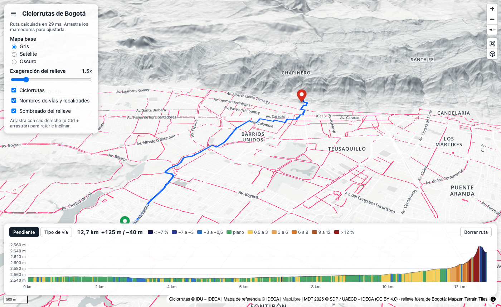

# Ciclorrutas de Bogotá

Visor web de las ciclorrutas de Bogotá sobre el relieve de la ciudad, con cálculo de rutas en bicicleta y perfil de elevación. Usa datos abiertos de IDECA y funciona entero en el navegador, sin servidor propio.

**[Abrir el visor en línea](https://diazrincon.github.io/bogota-ciclorutas/)** · [Descargar la aplicación de escritorio](https://github.com/diazrincon/bogota-ciclorutas/releases/latest)



## Qué hace

- **Relieve**: muestra el Modelo Digital de Terreno 2025 de Bogotá (LiDAR, 1 m en zona urbana) en 2D con sombreado o en 3D, con una vista isométrica para resaltarlo.
- **Ciclorrutas**: dibuja las 6.311 franjas de ciclorruta publicadas por el IDU.
- **Rutas**: calcula el camino entre dos puntos prefiriendo ciclorrutas y bicicarriles y evitando subidas y vías arteriales. Tarda entre 5 y 30 ms.
- **Perfil**: muestra la elevación de la ruta coloreada por pendiente o por tipo de vía, con distancia, subida y bajada acumuladas.
- **Nombres legibles**: los nombres de vías y localidades se dibujan aparte del fondo, así que se leen derechos con cualquier giro de la cámara.

## Cómo usarlo

Hay tres formas:

- **En línea**: <https://diazrincon.github.io/bogota-ciclorutas/>.
- **Aplicación de escritorio**: en [Releases](https://github.com/diazrincon/bogota-ciclorutas/releases/latest) hay un archivo para Windows, macOS y Linux. Al abrirlo, el visor aparece en su propia ventana, sin navegador ni instalación adicional. Necesita internet para el relieve y los mapas base.
- **Desde el código**, con Node.js 20 o superior:

```bash
npm install
npm run dev
```

Abre la dirección que imprime Vite (por defecto `http://localhost:5173`).

- El primer clic en el mapa marca el origen y el segundo el destino. Los marcadores se pueden arrastrar.
- Clic derecho y arrastrar (o Ctrl + arrastrar) rota e inclina la cámara.
- Los botones de arriba a la derecha llevan a la vista 2D de toda la red y a la vista isométrica.

`npm run build` genera el sitio estático en `dist/`.

## Publicación

- Cada cambio en `main` se despliega en GitHub Pages (`.github/workflows/pages.yml`).
- Cada tag `vX.Y.Z` crea un release con la aplicación de escritorio para cada sistema (`.github/workflows/release.yml`). Es el mismo sitio dentro de una ventana de [Electron](https://www.electronjs.org/) (`electron/main.cjs`).

Para probar la aplicación de escritorio en tu máquina: `npm run app`. Para empaquetarla: `npm run app:build` (deja el resultado en `release/`).

El nombre interno del producto va sin tilde (`Ciclorrutas de Bogota`) a propósito: con tilde, Electron 45 no encuentra sus procesos auxiliares en macOS y la aplicación se cierra al abrir.

## Datos

El repositorio incluye los datos ya procesados, así que la aplicación funciona recién clonada. Para regenerarlos:

```bash
npm run data
```

Solo requiere Python 3 (biblioteca estándar). Descarga unos 210 MB a `data/raw/`, que no se versiona, y tarda varios minutos. Los pasos son:

| Script | Qué hace |
| --- | --- |
| `scripts/gpkg_to_geojson.py` | Convierte `data/Ciclorruta.gpkg` a GeoJSON y calcula el recuadro de trabajo. |
| `scripts/descargar_redes.py` | Descarga de IDECA la red de biciusuarios, la malla vial, los puentes y las localidades. |
| `scripts/descargar_mdt.py` | Descarga el MDT remuestreado a unos 5 m sobre el recuadro. |
| `scripts/construir_red.py` | Construye el grafo de rutas con elevación (`public/data/red.bin`). |
| `scripts/construir_etiquetas.py` | Prepara los nombres de vías y localidades. |

## Cómo funciona

- **Mapa**: [MapLibre GL JS](https://maplibre.org/) con Vite, en JavaScript sin framework.
- **Relieve**: un protocolo propio (`src/dem-protocol.js`) pide cada tesela al servicio de imágenes de IDECA y la convierte al formato que MapLibre entiende. Solo consulta a IDECA dentro del recuadro de las ciclorrutas; fuera de él usa un modelo global de menor detalle.
- **Fondo**: otro protocolo (`src/base-protocol.js`) pide los mapas base de IDECA sin sus textos.
- **Rutas**: el grafo une la red de biciusuarios con la malla vial y tiene 125 mil cruces y 184 mil tramos, con un punto de elevación cada 10 m o menos. El navegador lo carga de un archivo binario de 17 MB y busca la ruta con A\* (`src/ruta.js`).
- **Costo de una ruta**: longitud de cada tramo × un factor según el tipo de vía, más 15 m por cada metro de subida. Los factores están en `src/red.js`.

## Limitaciones conocidas

- **Sentidos de circulación**: se asume que las vías de un solo sentido siguen la dirección en que está dibujado cada tramo. No está confirmado con IDECA, así que puede haber rutas en contravía.
- **Clasificación vial**: IDECA no publica la leyenda del campo de clase de la malla vial; arterial, intermedia, local y peatonal se dedujeron de los datos.
- **Conexiones entre redes**: la red de bicis y la malla vial casi no comparten puntos, así que se enlazan por cercanía (hasta 20 m). Eso permite pasar de una ciclorruta a la calle vecina en casi cualquier punto.
- **Nombres**: los de las vías vienen sin tildes en los datos de origen, y los municipios vecinos no tienen etiqueta.
- **Dependencia de IDECA**: el relieve y el fondo se piden en vivo a sus servicios. Si no responden, el relieve cae al modelo global y el fondo queda vacío.

No es una herramienta de navegación: úsala como referencia y verifica la ruta en la calle.

## Fuentes y licencias

El código está bajo licencia [MIT](LICENSE). Los datos y recursos de terceros conservan sus propias licencias:

| Recurso | Fuente | Licencia |
| --- | --- | --- |
| Ciclorrutas, red de biciusuarios, malla vial, puentes y localidades | [IDECA](https://www.ideca.gov.co/) – Infraestructura de Datos Espaciales de Bogotá (IDU, UAECD) | Datos abiertos; revisa la licencia de cada conjunto en IDECA |
| Modelo Digital de Terreno 2025 | SDP / UAECD – IDECA | CC BY 4.0 |
| Mapas base | Mapa de Referencia de IDECA | Servicio público de IDECA |
| Relieve fuera de Bogotá | [Mapzen Terrain Tiles](https://registry.opendata.aws/terrain-tiles/) | Varias fuentes abiertas, con atribución |
| Tipografía Open Sans Semibold (glifos en `public/fonts/`) | Google Fonts, vía las teselas de demostración de MapLibre | Apache 2.0 |
| MapLibre GL JS | [maplibre.org](https://maplibre.org/) | BSD de 3 cláusulas |
| Electron (aplicación de escritorio) | [electronjs.org](https://www.electronjs.org/) | MIT |

Este proyecto no está afiliado a IDECA ni a ninguna entidad del Distrito.

## Contribuir

Las contribuciones son bienvenidas; mira [CONTRIBUTING.md](CONTRIBUTING.md).
